<p align="center">
  
</p>

  

The navigation skeleton of a shopping app: four tabs — **Home, Favorites, Cart, Profile** — behind a bottom navigation bar. The interesting part is *how* the tabs switch: fragments are created once and then **shown and hidden**, not replaced, so each tab keeps its state.

## Features

- Bottom navigation with four destinations
- **State-preserving tab switching** — scroll position and input survive tab changes
- Each tab is its own fragment with a `newInstance()` factory
- View binding in the host activity

## How it works

All four fragments are added to the container at start-up and immediately hidden; only the active one is shown:

```kotlin
supportFragmentManager.beginTransaction()
    .hide(activeFragment)
    .show(cartFragment)
    .commit()
activeFragment = cartFragment
```

Compared with `replace()`, this avoids recreating the fragment's view on every tap — the same approach many production apps used before the Navigation component supported multiple back stacks.

## Project structure

```
com.example.onlineshop
├── screen/
│   ├── MainActivity.kt
│   ├── cart/CartFragment.kt
│   ├── favorite/FavoriteFragment.kt
│   ├── home/HomeFragment.kt
│   ├── profile/ProfileFragment.kt
```

<sub>5 source files · 134 lines of code · 5 layouts</sub>

## Tech stack

| | |
|---|---|
| **Language** | Kotlin |
| **UI** | XML layouts, View Binding |
| **Min / Target SDK** | 24 / 35 |

## Getting started

```bash
git clone https://github.com/rajabbov/OnlineShop.git
```

1. Open the folder in **Android Studio** (Ladybug or newer).
2. Let Gradle sync.
3. Run the `app` configuration on a device or emulator.

## Known limitations

- The tab screens are placeholders — product listing and cart logic are not implemented yet.

---

Made by **Ibrohimjon Rajabboyev** · [@rajabbov](https://github.com/rajabbov)
